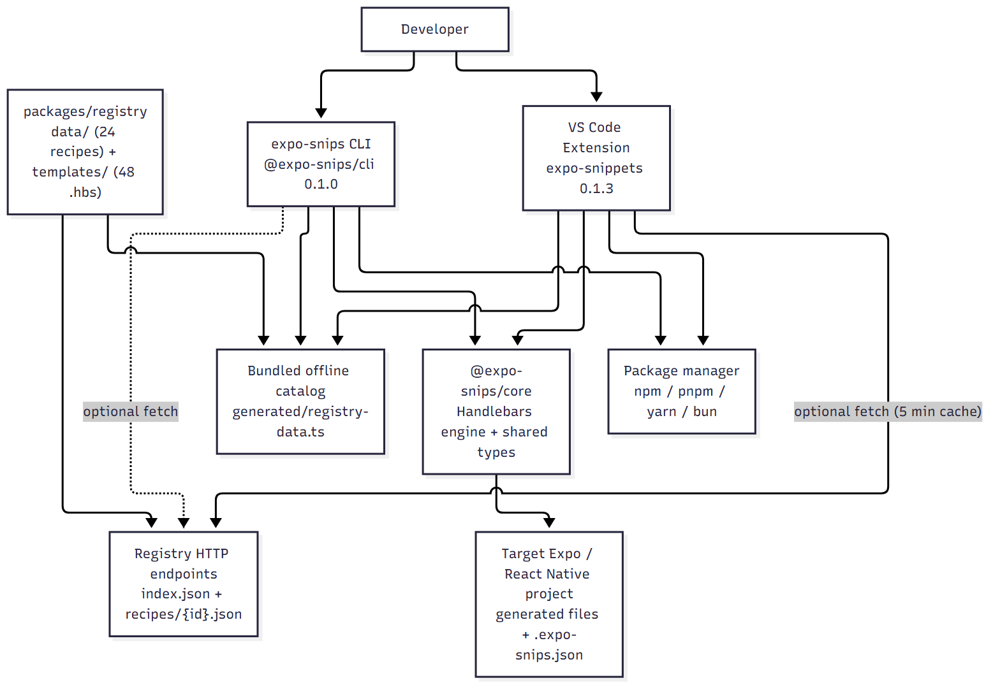
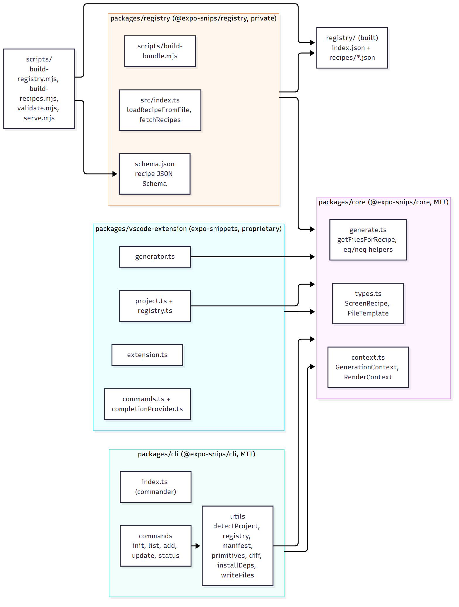
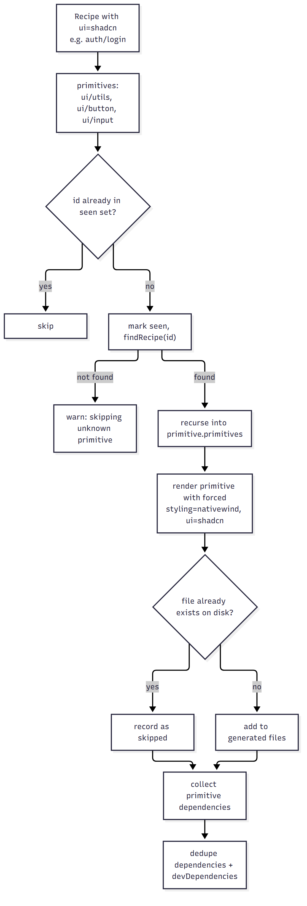
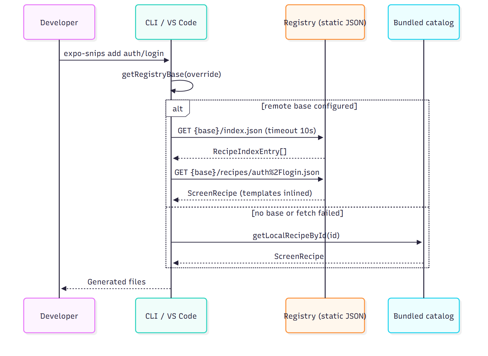
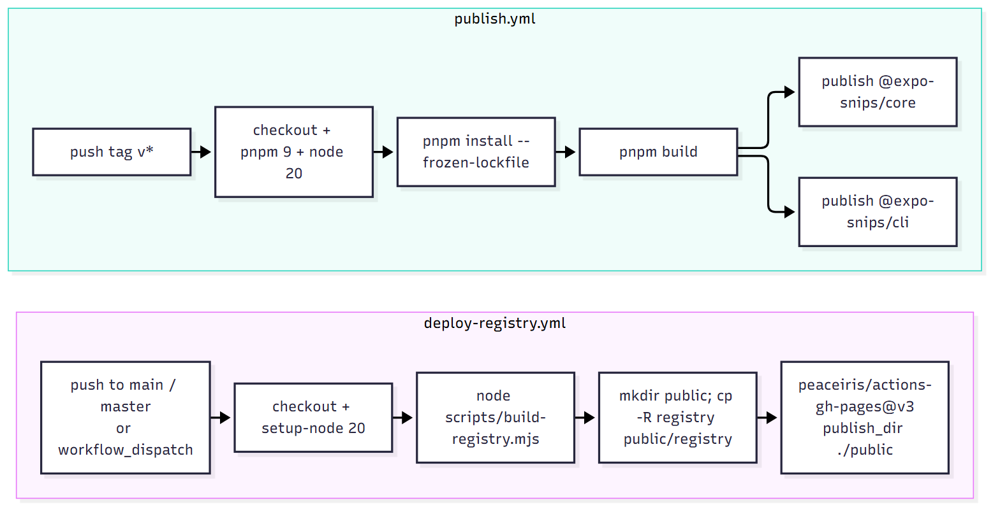
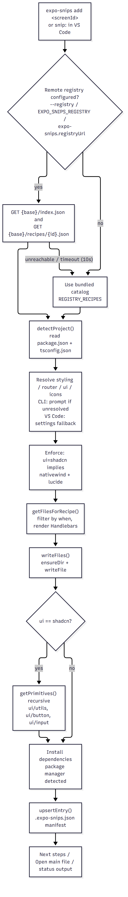
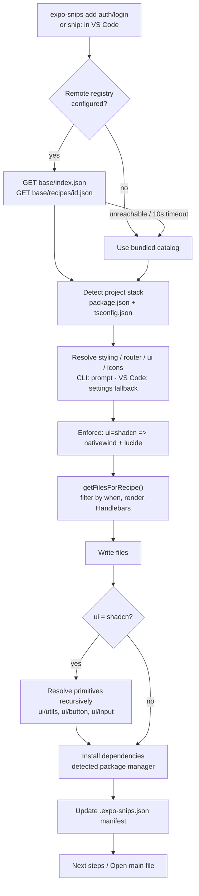

<div align="center">


# Expo Snips

### Complete, production-quality React Native / Expo screens — one command away.

**Expo Snips** is an open-source screen generator for **Expo / React Native**. It renders versioned, stack-aware "screen recipes" (login, onboarding, settings, dashboards, product grids, empty/error states, and more) into your existing project — as a **CLI** or a **VS Code extension** — with form validation, loading states and dependency installation included.

[-blue)](#license)
[](https://nodejs.org/)
[](https://pnpm.io/)
[](https://expo.dev/)
[](https://code.visualstudio.com/)
[](https://github.com/unkown812/expo-snips/stargazers)

[Quick Start](#quick-start) • [Screen Catalog](#screen-catalog) • [Architecture](#system-architecture) • [CLI Reference](#cli-reference) • [VS Code Workflow](#vs-code-workflow) • [Registry API](#registry-api)

</div>

---

> **No hosted demo — and that's intentional.** Expo Snips is a local developer tool, not a web app. There is no signup, account, SaaS dashboard or pricing model anywhere in the repository. You install it, run one command, and code appears in your project. See [Project Status](#project-status) for what is and isn't published.

---

## Overview

Writing Expo / React Native screens is repetitive. A single login screen needs a screen file, a form component, a validation schema, a hook, loading and error states, keyboard handling, safe areas, styling, and several new dependencies. Multiply that by auth flows, onboarding, dashboards, product grids and empty/error states, and a large share of app development becomes re-typing patterns you already know.

**Expo Snips turns that into a catalog lookup.**

```
$ expo-snips add auth/login
```

…or type `snip:` in any `.tsx` file inside VS Code. The tool:

1. fetches (or reuses a bundled copy of) the **screen catalog**,
2. **detects your project's stack** from `package.json` / `tsconfig.json`,
3. **renders Handlebars templates** conditional on that stack,
4. **writes complete screen files** into your project,
5. **installs recipe dependencies** with your package manager, and
6. records the install in a **`.expo-snips.json` manifest** so screens can be updated later.

The result is a working, validated, keyboard-safe screen that matches **your** router, styling, UI primitives and icon library — not a generic paste that you have to rewire.

- **Category:** Developer tooling — React Native / Expo screen generator
- **Surfaces:** CLI (`expo-snips`) and VS Code extension (`expo-snippets`), sharing one generation engine (`@expo-snips/core`)
- **Built for:** solo builders, product teams, and agencies shipping Expo apps in TypeScript or JavaScript
- **License:** MIT for `@expo-snips/core` and `@expo-snips/cli`; the VS Code extension is proprietary (see [License](#license))

---

## The Problem → The Approach → The Result

```text
The Problem
  Expo / React Native screens are rebuilt by hand in every project:
  forms + validation + loading/error states + keyboard avoidance +
  safe areas + styling + dependency setup. Slow, inconsistent, error-prone.

Why existing approaches fall short
  • Copy-paste from another project  → brittle, unvalidated, doesn't match your stack
  • Full-app boilerplate templates    → generates an entire project, not one screen
  • Component libraries               → give you parts, not a wired screen
  • Hand-writing everything           → most flexible, least productive

The Expo Snips approach
  A versioned registry of stack-aware screen recipes, rendered into whole
  screens that adapt to the project you already have — from CLI or editor.

The Result
  Complete, validated, keyboard-safe screens in seconds, tracked in a manifest
  and updatable as the catalog improves.
```

---

## Key Features

### Screen generation
- **Whole screens, not snippets** — a recipe can generate a screen, a form component and hooks together (e.g. `auth/login` → `app/login/index.tsx` + `components/LoginForm.tsx` + `hooks/useLogin.ts`).
- **One command / one abbreviation** — `expo-snips add <screenId>` or type `snip:` in the editor.
- **Interactive picker** — run `expo-snips add` with no argument to choose from the catalog.

### Stack-aware output
- **Auto-detection** of router, styling, UI primitives, icon library and TypeScript/JavaScript from `package.json` and `tsconfig.json`.
- **NativeWind _and_ StyleSheet** output; **TypeScript _and_ JavaScript** output.
- **Native and shadcn-style** UI primitives.
- **Conditional Handlebars rendering** (`eq` / `neq` helpers) produces different output per stack from a single recipe.

### Quality baked into every template
- Form validation with **`react-hook-form` + `zod`**.
- Loading spinners, disabled states and inline error messages.
- `KeyboardAvoidingView` and `SafeAreaView` handling.
- `expo-router` navigation wiring.

### Zero-config dependency setup
- Detects **npm / pnpm / yarn / bun** from lockfiles and installs recipe dependencies automatically.
- Recursively resolves **shadcn-style primitives** (`ui/button`, `ui/input`, `ui/utils`) and skips files that already exist.

### Versioned, updateable installs
- Records every install in **`.expo-snips.json`** (recipe id, version, options, variant, files, timestamp).
- `expo-snips status` to inspect tracked screens.
- `expo-snips update` to regenerate at the latest recipe version with a **line-level diff preview** before applying.

### Editor-native workflow (VS Code)
- **Inline completion** after typing `snip:` or `expo-snips:` in TS/TSX/JS/JSX files.
- **Command palette:** *Expo Snips: Add Screen…*
- **Status bar** button (`$(sparkle) Expo Snips`).
- **Offline bundled catalog** — works immediately after install with no network.
- **"Open main file"** quick action and terminal-based dependency install.

### Catalog & distribution
- **24 screen recipes** across 11 categories, backed by **48 Handlebars templates**.
- **Configurable registry** — env var, CLI flag or VS Code setting, with automatic fallback to the bundled catalog.
- **Registry build & deploy automation** and an npm publish workflow (see [CI/CD](#cicd--deployment)).

---

## Screen Catalog

A recipe is a JSON definition (`packages/registry/data/**`) plus its Handlebars templates (`packages/registry/templates/**`). Every handlerless screen is authored for TypeScript-first projects and renders a JavaScript variant when requested.

### Authentication
| Recipe ID | Name | Version | Tags |
|---|---|---|---|
| `auth/login` | Login Screen | 0.3.0 | auth, login, form |
| `auth/register` | Register Screen | 0.2.0 | auth, register, signup, form |
| `auth/forgot-password` | Forgot Password Screen | 0.2.0 | auth, forgot-password, form |
| `auth/otp-verification` | OTP Verification Screen | 0.2.0 | auth, otp, verification |

### App chrome
| Recipe ID | Name | Version | Tags |
|---|---|---|---|
| `app/home` | Home Dashboard Screen | 0.1.0 | app, home, dashboard |
| `app/notifications` | Notifications Screen | 0.1.0 | app, notifications, list |
| `app/profile` | Profile Screen | 0.1.0 | app, profile, account |
| `app/search` | Search Screen | 0.1.0 | app, search |
| `app/settings` | Settings Screen | 0.1.0 | app, settings, preferences |

### Onboarding
| Recipe ID | Name | Version | Tags |
|---|---|---|---|
| `onboarding/welcome` | Welcome Screen | 0.2.0 | onboarding, welcome, intro |
| `onboarding/features` | Features Onboarding Screen | 0.1.0 | onboarding, features, intro |
| `onboarding/permissions` | Permissions Screen | 0.2.0 | onboarding, permissions, notifications |

### Commerce, data & content
| Recipe ID | Name | Version | Tags |
|---|---|---|---|
| `ecommerce/products` | Product Listing Screen | 0.1.0 | ecommerce, products, list, catalog |
| `ecommerce/product-details` | Product Details Screen | 0.1.0 | ecommerce, product, details |
| `dashboard/analytics` | Analytics Dashboard Screen | 0.1.0 | dashboard, analytics, stats, charts, metrics |
| `calendar/schedule` | Calendar Schedule Screen | 0.1.0 | calendar, schedule, events, planner |
| `chat/conversations` | Chat Conversations List | 0.1.0 | chat, messages, conversations, list |
| `content/article-reader` | Article Reader Screen | 0.1.0 | content, article, reader, blog, detail |
| `map/location` | Map Location Screen | 0.1.0 | map, location, navigation, places |

### Utility states
| Recipe ID | Name | Version | Tags |
|---|---|---|---|
| `utility/empty` | Empty State Screen | 0.1.0 | utility, empty, state |
| `utility/error` | Error State Screen | 0.1.0 | utility, error, state |

### shadcn-style UI primitives
| Recipe ID | Name | Version | Output |
|---|---|---|---|
| `ui/button` | Button primitive | 0.1.0 | `components/ui/button.tsx` |
| `ui/input` | Input primitive | 0.1.0 | `components/ui/input.tsx` |
| `ui/utils` | `cn` utility | 0.1.0 | `lib/utils.ts` |

> **Variants:** the variant system is implemented (CLI `--variant`, VS Code variant picker, per-variant template overrides). One variant is currently authored — **`glass`** (Glassmorphism) — on `app/home`, `auth/login` and `onboarding/welcome`. The other recipes define no variants.

<details>
<summary><strong>Bundled vs. remote registry</strong></summary>

<br/>

The catalog is compiled into both the CLI and the VS Code extension at build time (`scripts/lib/build-recipes.mjs` → `src/generated/registry-data.ts`), so out of the box **no network is required**.

If a remote registry is configured (`--registry`, `EXPO_SNIPS_REGISTRY`, or the `expo-snips.registryUrl` setting), the tool fetches from it instead and **falls back to the bundled catalog** if the host is unreachable or exceeds a 10-second timeout.

</details>

---

## Technology Stack

| Layer | Technology |
|---|---|
| Language | TypeScript (strict, ES2020; `tsconfig.base.json`) |
| Runtime | Node.js **≥ 18** |
| Package manager | pnpm workspace (`packages/*`) |
| Template engine | **Handlebars** (`@expo-snips/core`) |
| CLI framework | `commander` + `prompts` + `chalk` + `fs-extra` |
| VS Code extension | VS Code API `^1.80.0`, bundled with **esbuild**, packaged with `@vscode/vsce` |
| Recipe data | JSON recipes + JSON Schema (`packages/registry/schema.json`) |
| Generated screens target | Expo / React Native, Expo Router, `react-hook-form`, `zod`, `@hookform/resolvers`, NativeWind, `lucide-react-native`, `class-variance-authority`, `clsx`, `tailwind-merge`, `expo-notifications` (per recipe) |
| CI/CD | GitHub Actions (GitHub Pages registry deploy + npm publish) |
| Data persistence | None — a single local JSON manifest (`.expo-snips.json`) |

No database, no server application, no AI/ML, and no external SaaS are used. The only server in the repository is a local static-JSON fixture (`scripts/serve.mjs`).

---

## System Architecture

<p align="center">
  
</p>

The CLI and the VS Code extension are thin surfaces over a single shared engine, so a screen generated from the editor is identical to one generated from the terminal.

<br/>

<p align="center">
  <br/>
  <em>Component architecture</em>
</p>

<p align="center">
  <br/>
  <em>Recursive primitive resolution</em>
</p>

<p align="center">
  <br/>
  <em>Registry API sequence</em>
</p>

<p align="center">
  <br/>
  <em>CI/CD and deployment</em>
</p>

</details>

---

## How a Screen Is Generated

<p align="center">
  
</p>



**Stack detection rules** (`packages/cli/src/utils/detectProject.ts`, mirrored in the extension):

| Detected | Checked in `package.json` / filesystem |
|---|---|
| Router | `expo-router` → expo-router; else `@react-navigation/native` → react-navigation |
| Styling | `nativewind` → nativewind; else stylesheet |
| UI primitives | `@shadcn/ui` or `react-native-reusables` → shadcn; else native |
| Icons | `lucide-react-native` → lucide; else none |
| TypeScript | presence of `tsconfig.json` |

---

## Quick Start

### Prerequisites
- **Node.js ≥ 18**
- **pnpm 9+** (the repo is a pnpm workspace)
- An Expo / React Native project to generate into (optional — you can also scaffold one with `expo-snips init`)

### 1. Clone and build the monorepo

```bash
git clone https://github.com/unkown812/expo-snips.git
cd expo-snips
pnpm install
pnpm build            # builds core, cli, registry and the VS Code extension
```

### 2. Validate the catalog (optional)

```bash
pnpm validate         # schema-checks every recipe and confirms its templates exist
```

### 3. Run the CLI from the repo

```bash
node packages/cli/dist/index.js list
node packages/cli/dist/index.js add auth/login --styling nativewind --ui shadcn
```

Run it from **inside your Expo project** so files are written there and dependencies are detected and installed. Add `--no-install` to skip automatic dependency installation.

### 4. Install the VS Code extension

The extension is **not published to the Marketplace and has no tagged releases yet**, so you install it from a locally built package. Build one, then install it:

```bash
pnpm --filter expo-snippets package    # esbuild + vsce → packages/vscode-extension/expo-snippets-<version>.vsix
```

1. In VS Code open the Command Palette (`Ctrl/Cmd + Shift + P`).
2. Run **Extensions: Install from VSIX…** and select the generated `.vsix` file.
3. Reload VS Code. Open your Expo project and type `snip:` in a `.tsx` file.

> Packaged `.vsix` files are git-ignored build artifacts — build the extension from source to get one.

---

## Usage

### CLI workflow

```bash
# (optional) create a fresh Expo project — runs npx create-expo-app@latest
expo-snips init --name my-app

# browse the catalog
expo-snips list

# generate a screen (interactive if you omit the id)
expo-snips add auth/login
expo-snips add ecommerce/products --styling stylesheet --icons none
expo-snips add app/home --variant glass

# manage what you've installed
expo-snips status
expo-snips update --yes
```

After generation the CLI prints a "Next steps" summary; review the files, wire your real backend logic, and run your Expo app.

### VS Code workflow

1. Open your Expo project as the workspace root.
2. In any `.ts`, `.tsx`, `.js` or `.jsx` file, type `snip:`.
3. Pick a screen from the completion list — the files are written, primitives resolved, the manifest updated, and dependencies installed in an *Expo Snips* terminal.
4. Use the **Open main file** action to jump straight to the generated entry file.

You can also run **Expo Snips: Add Screen…** from the Command Palette or click the sparkle icon in the status bar.

---

## CLI Reference

`expo-snips` exposes five commands (`packages/cli/src/index.ts`).

| Command | Description |
|---|---|
| `init` | Create a new Expo project via `npx create-expo-app@latest`. Refuses to overwrite an existing `app.json`. |
| `list` | List every screen in the (bundled or remote) catalog. |
| `add [screenId]` | Generate a screen, install its dependencies, and record it in the manifest. |
| `update [screenId]` | Regenerate tracked screens to the latest recipe version, with a diff preview. |
| `status` | Show the screens tracked in `.expo-snips.json`. |

### `add` options

| Flag | Values | Notes |
|---|---|---|
| `--styling <styling>` | `nativewind`, `stylesheet` | Validated against the recipe's supported list |
| `--router <router>` | `expo-router`, `react-navigation` | Validated against the recipe |
| `--ui <ui>` | `native`, `shadcn` | `shadcn` forces NativeWind + lucide |
| `--icons <icons>` | `lucide`, `none` | |
| `--variant <variant>` | e.g. `glass` | Only where the recipe defines variants |
| `--typescript` | | Force TypeScript output (default when detectable) |
| `--javascript` | | Emit `.js`/`.jsx` instead of `.ts`/`.tsx` |
| `--no-install` | | Skip dependency installation |
| `--registry <url>` | | Remote registry base URL (overrides `EXPO_SNIPS_REGISTRY`) |

`list` and `update` also accept `--registry <url>`; `update` additionally accepts `--yes` to apply changes without confirmation.

---

## Configuration

| Setting / variable | Where | Default | Purpose |
|---|---|---|---|
| `EXPO_SNIPS_REGISTRY` | Environment | *(empty)* | Remote registry base URL for the CLI |
| `PORT` | Environment | `3000` | Port for the local registry server (`scripts/serve.mjs`) |
| `expo-snips.registryUrl` | VS Code setting | *(empty → bundled catalog)* | Remote registry base URL for the extension |
| `expo-snips.defaultStyling` | VS Code setting | `nativewind` | Fallback when styling can't be detected |
| `expo-snips.defaultRouter` | VS Code setting | `expo-router` | Fallback when the router can't be detected |
| `expo-snips.defaultUi` | VS Code setting | `native` | Fallback when UI primitives can't be detected |
| `expo-snips.defaultIcons` | VS Code setting | `lucide` | Fallback when icons can't be detected |
| `expo-snips.installDependencies` | VS Code setting | `true` | Install recipe dependencies after generation |

Resolver precedence for the registry base is **explicit flag → `EXPO_SNIPS_REGISTRY` → empty (bundled catalog)** for the CLI, and **setting → empty (bundled catalog)** for the extension. There is **no `.env` file and no required secret** to run the tool locally.

> The `defaultStyling`, `defaultUi` and `defaultIcons` enums also list `tamagui`, `custom` and `vector-icons`. These are **not implemented** in the current recipe catalog or CLI choices — treat them as reserved options.

### Local registry server

```bash
pnpm serve    # builds the registry, then serves it at http://localhost:3000
```

Then point either surface at it:

```bash
expo-snips list --registry http://localhost:3000
```

or set `expo-snips.registryUrl` to `http://localhost:3000` in VS Code.

---

## Registry API

The registry is a static, CORS-enabled JSON endpoint — no authentication. The deployed layout is produced by `scripts/build-registry.mjs`.

**Base URL:** configurable (see [Configuration](#configuration)); the value compiled into the code is `https://registry.expo-snips.dev`. **This host is currently unreachable, and the tool falls back to the bundled catalog** — see [Project Status](#project-status).

| Method | Endpoint | Description |
|---|---|---|
| `GET` | `{base}/index.json` | Array of catalog index entries (`id`, `name`, `description`, `version`, `typescript`, `tags`, `supported`) |
| `GET` | `{base}/recipes/{id}.json` | A full recipe, where `{id}` is the URL-encoded recipe id (e.g. `auth%2Flogin`) |
| `GET` | `{base}/schema.json` | JSON Schema for a recipe (`packages/registry/schema.json`) |

Both runtime clients apply a **10-second `AbortController` timeout**; the VS Code client also caches the remote index for **5 minutes** and rate-limits retries on unreachable hosts.

<details>
<summary><strong>Example: <code>GET /recipes/auth%2Flogin.json</code> (abridged)</strong></summary>

```json
{
  "id": "auth/login",
  "name": "Login Screen",
  "version": "0.3.0",
  "framework": "react-native",
  "runtime": "expo",
  "typescript": true,
  "supported": {
    "styling": ["nativewind", "stylesheet"],
    "router": ["expo-router", "react-navigation"],
    "ui": ["native", "shadcn"],
    "icons": ["lucide", "none"]
  },
  "dependencies": ["react-hook-form", "zod", "@hookform/resolvers", "lucide-react-native"],
  "files": [
    {
      "path": "app/login/index.tsx",
      "when": { "router": ["expo-router"], "ui": ["native"] },
      "templateFile": "auth/login/app.login.index.hbs"
    }
  ],
  "variants": [{ "id": "glass", "label": "Glassmorphism" }],
  "primitives": ["ui/utils", "ui/button", "ui/input"]
}
```

Note that `templateFile` references are **inlined at build time** — the emitted registry (and the bundled catalog) contains the resolved template strings, so consumers never need filesystem access to render.

</details>

---

## Data Model & Local State

There is **no database**. All state lives in a single JSON manifest, `.expo-snips.json`, written into your project root by both the CLI and the extension.

```jsonc
{
  "version": 1,
  "installs": [
    {
      "recipeId": "auth/login",
      "recipeVersion": "0.3.0",
      "installedAt": "2026-10-17T12:00:00.000Z",
      "options": {
        "styling": "nativewind",
        "router": "expo-router",
        "ui": "native",
        "icons": "lucide",
        "typescript": true
      },
      "variant": "glass",
      "files": ["app/login/index.tsx", "components/LoginForm.tsx", "hooks/useLogin.ts"]
    }
  ]
}
```

`status` reads it; `update` compares regenerated content against disk with a **longest-common-subsequence diff** (`packages/cli/src/utils/diff.ts`) before writing, and then bumps the stored recipe versions.

---

## Project Structure

```text
expo-snips/
├── packages/
│   ├── core/                 # @expo-snips/core — Handlebars engine + shared types (MIT)
│   │   └── src/              # types.ts, generate.ts, context.ts
│   ├── cli/                  # @expo-snips/cli — terminal CLI, bin: "expo-snips" (MIT)
│   │   ├── src/commands/     # init, list, add, update, status
│   │   ├── src/utils/        # detectProject, registry, manifest, primitives, installDeps, diff, writeFiles
│   │   └── src/generated/    # build-time offline catalog (git-ignored)
│   ├── registry/             # @expo-snips/registry — recipes, templates, schema (private)
│   │   ├── data/             # 24 recipe JSON files
│   │   ├── templates/        # 48 Handlebars (.hbs) templates
│   │   └── schema.json       # JSON Schema for recipes
│   └── vscode-extension/     # expo-snippets — VS Code extension (proprietary)
│       ├── src/              # extension, commands, completionProvider, generator, project, registry
│       ├── assets/logo.png   # extension icon
│       └── *.vsix            # local packaged builds (git-ignored)
├── registry/                 # built, deployable registry (index.json + recipes/*.json)
├── scripts/
│   ├── build-registry.mjs    # compile data/ + templates/ → registry/
│   ├── validate.mjs          # schema + template validation
│   ├── serve.mjs             # local static registry server (CORS, path-traversal guard)
│   └── lib/build-recipes.mjs # shared recipe loader / template inliner
├── documents/                # reverse-engineered documentation suite (LaTeX source, PDF, DOCX)
├── .github/workflows/        # deploy-registry.yml, publish.yml
├── package.json              # workspace root scripts
├── pnpm-workspace.yaml
├── tsconfig.base.json
└── README.md
```

### Root scripts

| Script | Command | Purpose |
|---|---|---|
| `pnpm build` | `pnpm -r build` | Build all packages |
| `pnpm validate` | `node scripts/validate.mjs` | Validate recipes against the schema and check templates |
| `pnpm build:registry` | `node scripts/build-registry.mjs` | Emit the deployable `registry/` folder |
| `pnpm serve` | build registry + serve | Serve the registry locally on `:3000` |

> The root `package.json` also declares `dev` and `test` as `pnpm -r dev` / `pnpm -r test`, but **no package implements those scripts** — see [Testing](#testing).

---

## Development

### Core engine

`@expo-snips/core` exports the recipe types and the rendering functions (`getFilesForRecipe`, `renderTemplate`). It registers `eq` / `neq` Handlebars helpers and filters `files` by their `when` conditions before rendering. Per-styling and per-variant template overrides are resolved here. Build with:

```bash
pnpm --filter @expo-snips/core build
```

### CLI

```bash
pnpm --filter @expo-snips/cli build
node packages/cli/dist/index.js list
```

`pnpm --filter @expo-snips/cli build` first runs `scripts/prepare-registry.mjs`, which inlines the recipe catalog into `src/generated/registry-data.ts`.

### VS Code extension

```bash
pnpm --filter expo-snippets build      # bundle to out/extension.js (esbuild, CJS, node18)
pnpm --filter expo-snippets watch      # rebuild on change
pnpm --filter expo-snippets typecheck  # tsc --noEmit
pnpm --filter expo-snippets package    # esbuild + vsce package
```

To debug: open `packages/vscode-extension` in VS Code and press **F5** to launch an Extension Development Host.

### Authoring a new recipe

1. Add a JSON file under `packages/registry/data/<category>/<name>.json` that conforms to `packages/registry/schema.json`.
2. Add the referenced `.hbs` templates under `packages/registry/templates/`.
3. Run `pnpm validate` to schema-check the recipe and confirm every `templateFile` exists.
4. Run `pnpm build:registry` to emit the deployable registry, and rebuild the CLI/extension to refresh their bundled catalogs.

---

## Testing

**There is currently no test infrastructure in this repository.** No test files, test runners or test scripts are implemented — the root `pnpm test` target exists but resolves to nothing. This is tracked as a known gap (see [Roadmap](#roadmap) and [Known Limitations](#known-limitations)).

What *is* available for verifying changes:

- `pnpm validate` — schema-validates all 24 recipes and asserts every referenced template exists.
- `pnpm --filter expo-snippets typecheck` — TypeScript type checking for the extension.
- Manual verification by generating screens into a scratch Expo project with `node packages/cli/dist/index.js add …`.

---

## CI/CD & Deployment

Three GitHub Actions workflows exist under `.github/workflows/`:

| Workflow | Trigger | What it does |
|---|---|---|
| **CI** | push to `main`/`master`, pull requests, manual | Installs (frozen lockfile), runs `pnpm validate`, `pnpm build`, and the extension type check |
| **Deploy Registry** | push to `main`/`master`, manual | Runs `scripts/build-registry.mjs`, copies `registry/` into `public/registry`, and deploys `public/` to **GitHub Pages** via `peaceiris/actions-gh-pages@v3` |
| **Publish Packages** | push of a `v*` tag | Installs (frozen lockfile), runs `pnpm build`, and publishes `@expo-snips/core` and `@expo-snips/cli` to **npm** (requires an `NPM_TOKEN` secret) |

The VS Code extension is **packaged manually** with `vsce` — there is no automated pipeline for it (the CI workflow only type-checks it).

---

## Performance & Reliability Characteristics

No wall-clock benchmarks or Lighthouse-style metrics are published (none were measured). The following are verifiable design facts:

- **Offline-first:** the full catalog ships inside the CLI and extension, so generation needs no network by default.
- **Bounded network access:** registry requests use a 10-second `AbortController` timeout with graceful fallback to the bundled catalog.
- **Cached remote index:** the VS Code client caches the remote index for 5 minutes and backs off retrying unreachable hosts.
- **Batched fetches:** `getRecipesByIds` resolves multiple recipes concurrently via `Promise.all`.
- **Diff cost:** the update preview uses an O(n·m) longest-common-subsequence diff over file lines — fine for source files, not designed for large binaries.

---

## Project Status

| Property | Value |
|---|---|
| Project type | Developer tooling — Expo / React Native screen generator (CLI + VS Code extension) |
| Maturity | **Early / MVP** — all packages at `0.1.0`; extension at `0.1.3` |
| Primary language | TypeScript |
| Platform | Node.js ≥ 18 (CLI); VS Code ^1.80.0 (extension) |
| Repository | [github.com/unkown812/expo-snips](https://github.com/unkown812/expo-snips) (branch: `master`) |
| Packages | 4 (2 MIT, 1 private, 1 proprietary) |
| Screen recipes | 24 (48 templates) |
| Tests | None |
| Database / backend | None |
| License | MIT (core + CLI); proprietary (VS Code extension) |

**Verified reality check (as of this README):**

- `@expo-snips/core` and `@expo-snips/cli` are **not yet published on npm** (the publish workflow is configured but the package names resolve to 404 on the npm registry). Install and run from this repository.
- The default registry host `registry.expo-snips.dev` and the GitHub Pages registry path **did not resolve** when checked. Because the catalog is bundled, this has **no effect** on normal use — it only means a *remote* registry is not currently reachable.
- The VS Code extension is **not on the Marketplace and has no tagged releases**; package it locally with `pnpm --filter expo-snippets package` (the `.vsix` files in the working tree, if present, are git-ignored local artifacts).

---

## Known Limitations

- **No tests.** Testing infrastructure is not implemented (see [Testing](#testing)).
- **No CI for the VS Code extension.** It is packaged manually; only the registry and npm publishing are automated.
- **Placeholder business logic.** Generated auth hooks simulate work with a delay and an `Alert` and carry a `// Replace with your actual authentication logic` comment. They are meant to be wired to your backend.
- **⚠️ The generated mock login hook logs credentials to the console** (`console.log('Login attempt', { email, password })`). Replace it before shipping.
- **Mock content.** Generated screens ship sample data (a name, sample products, stats) that you replace.
- **Router coverage is Expo Router-first.** All recipes target `expo-router`; `react-navigation` is only supported for `auth/login` and `auth/register`.
- **Reserved-but-unimplemented options.** `tamagui`, `vector-icons` and `custom` UI are declared in types/schema/settings but are not implemented in any recipe or CLI choice.
- **shadcn UI requires NativeWind + lucide** and is enforced by the generator.
- **Variants are barely populated.** The variant system works, but only the `glass` variant exists, on 3 recipes.
- **Unverifiable remote registry.** A hosted registry is designed for but not confirmed live; the bundled catalog is the source of truth.
- **Mixed licensing.** The VS Code extension is proprietary while `core` and `cli` are MIT — review each package before reuse.

---

## Security

There are no accounts, tokens, or credentials in this project to protect — but a few implementation details are worth knowing:

- **No secrets in the repo.** No `.env` file or hard-coded keys exist; the only secret is `NPM_TOKEN`, supplied through GitHub Actions at publish time.
- **Graceful network failure.** Registry fetches are aborted after 10 s and fall back to the bundled catalog rather than hanging.
- **Local server hardening.** `scripts/serve.mjs` confines every request to the registry root to prevent path traversal (`filePath` is checked against the resolved root) and sends permissive CORS headers, which is appropriate because the registry is public, read-only data.
- **Generated code is a starting point, not a security boundary.** The mock login hook logs credentials (see above) and does not authenticate anyone — replace it with real, vetted auth logic.
- **Dependency installation executes your package manager** with package names that come from recipe definitions. Only generate from a registry you trust (use the bundled catalog or your own hosted registry).

---

## Roadmap

Derived from the repository's own roadmap and stated gaps. Completed items reflect what is actually implemented today.

**Shipped**
- [x] CLI with `init`, `list`, `add`, `update`, `status`
- [x] 24 stack-aware screen recipes with 48 Handlebars templates
- [x] Project stack auto-detection (router / styling / ui / icons / TS)
- [x] Automated dependency installation (npm / pnpm / yarn / bun)
- [x] shadcn-style primitive resolution (`ui/button`, `ui/input`, `ui/utils`)
- [x] `.expo-snips.json` manifest with diff-preview `update`
- [x] VS Code extension with `snip:` completion, command palette, status bar and offline catalog
- [x] Registry build script + GitHub Pages deploy workflow + npm publish workflow

**Planned**
- [ ] Tamagui styling support
- [ ] Vector Icons support
- [ ] Custom UI primitive support
- [ ] Expanded screen catalog (more auth, e-commerce and utility screens)
- [ ] Testing infrastructure (unit + integration tests)
- [ ] CI/CD pipeline for the VS Code extension
- [ ] Publish `@expo-snips/core` and `@expo-snips/cli` to npm and go live with the hosted registry

---

## Contributing

Contributions are welcome — the catalog is designed to grow through new recipes.

- **Add a screen:** create a recipe JSON under `packages/registry/data/` and its templates under `packages/registry/templates/`, then run `pnpm validate`.
- **Improve the engine or tooling:** work in `packages/core`, `packages/cli` or `packages/vscode-extension` and rebuild the affected package.
- **Keep the surfaces in sync:** the CLI and the extension share `@expo-snips/core`; prefer fixing behavior there when both are affected.

Read [`CONTRIBUTING.md`](./CONTRIBUTING.md) for the full workflow (setup, checks to run, PR expectations), [`AGENTS.md`](./AGENTS.md) for architecture and conventions, and [`SECURITY.md`](./SECURITY.md) to report vulnerabilities privately. Notable changes are tracked in [`CHANGELOG.md`](./CHANGELOG.md).

---

## License

This is a **mixed-license monorepo** — check the package you intend to use:

| Package | License |
|---|---|
| `@expo-snips/core` | **MIT** (declared in `packages/core/package.json`) |
| `@expo-snips/cli` | **MIT** (declared in `packages/cli/package.json`) |
| `@expo-snips/registry` | Private package, **no license field** |
| `expo-snippets` (VS Code extension) | **Proprietary** — see [`packages/vscode-extension/LICENSE`](packages/vscode-extension/LICENSE); © 2026 Jay Jogane |

There is no root `LICENSE` file; licensing is declared per package.

---

## Credits

- **[Handlebars](https://handlebarsjs.com/)** — the template engine behind `@expo-snips/core`
- **[Expo](https://expo.dev/)** & **[React Native](https://reactnative.dev/)** — the target runtime for generated screens
- **[Expo Router](https://docs.expo.dev/router/introduction/)**, **[react-hook-form](https://react-hook-form.com/)**, **[Zod](https://zod.dev/)** — the patterns embedded in the generated screens
- **[NativeWind](https://www.nativewind.dev/)**, **[class-variance-authority](https://cva.style/)**, **[lucide](https://lucide.dev/)** — styling, variant and icon tooling used by generated code
- **[commander](https://github.com/tj/commander.js)**, **[prompts](https://github.com/terkelg/prompts)**, **[chalk](https://github.com/chalk/chalk)**, **[fs-extra](https://github.com/jprichardson/node-fs-extra)**, **[esbuild](https://esbuild.github.io/)**, **[@vscode/vsce](https://github.com/microsoft/vscode-vsce)** — CLI and extension tooling
- **The VS Code Extension API** — editor integration

---

## Author

**Jay Jogane** — author of the `expo-snippets` VS Code extension and this monorepo.

- GitHub: [@unkown812](https://github.com/unkown812)

---

## Documentation Suite

Beyond this README, `documents/` contains a full reverse-engineered documentation suite generated from repository analysis: business and requirements documents, architecture and design chapters, API/auth/data-flow references, security/performance/testing/deployment chapters, and appendices — compiled as **LaTeX source**, a **PDF** (~203 pages) and a **DOCX** (~170 tables) under `documents/output/`. See [`documents/README.md`](documents/README.md) for the index and build instructions.

---

## Working in This Repository

| File | Purpose |
|---|---|
| [`AGENTS.md`](./AGENTS.md) | Architecture, conventions, commands and guardrails for AI coding agents and contributors |
| [`CONTRIBUTING.md`](./CONTRIBUTING.md) | Setup, ways to contribute, checks to run, and PR expectations |
| [`SECURITY.md`](./SECURITY.md) | How to report vulnerabilities privately |
| [`CHANGELOG.md`](./CHANGELOG.md) | Notable monorepo changes (see also the extension's own changelog) |
| [`.editorconfig`](./.editorconfig) | Shared editor settings (2-space indent, LF, UTF-8) |
| [`.gitattributes`](./.gitattributes) | Binary/generated-file handling for Git |
| [`.nvmrc`](./.nvmrc) | Node version used by CI (`20`) |
| [`.github/`](./.github) | CI workflow, issue and pull-request templates, Dependabot config |

---

<div align="center">

**If Expo Snips is useful to you, a ⭐ on [GitHub](https://github.com/unkown812/expo-snips) helps other Expo developers find it.**

<br/>

*Beautiful, production-ready React Native screens — one command away.*

</div>
